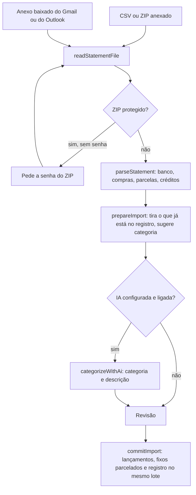

# 11. Importação de fatura e serviço de IA

Documento de referência da alimentação do mês por fatura de cartão: os
formatos de CSV conhecidos, o caminho do arquivo até a revisão, o registro que
impede duplicata, a busca no email (Gmail, Outlook e Hotmail) e o serviço de IA
que organiza a fatura.

O serviço de IA segue o desenho do serviço de IA do Colab Notebook Arena
(provedores atrás de uma função só, fila de modelos com reserva e quarentena,
saída em JSON no texto, repetição só para erro de conteúdo, prazo da operação
inteira), adaptado a um app **sem servidor**: aqui quem chama o provedor é o
navegador. A seção 11.12 lista o que foi trazido, o que mudou e o que ficou de
fora.

> Este documento segue as regras de [00-regras-para-ia.md](00-regras-para-ia.md).
> Ao mudar qualquer peça descrita aqui (formato de fatura, chave de
> importação, prompt, limite, precedência de configuração), atualize a seção
> correspondente no mesmo trabalho.

## 11.1 Visão geral e decisões

A tela Adicionar abre no modo **Importar fatura**: o usuário escolhe a origem
(a mesma para a fatura inteira), anexa o CSV (ou o ZIP com o CSV dentro, ou
busca o anexo no email) e revisa a categoria de cada compra antes de gravar.
Só aparece o que ainda não entrou no app. O lançamento à mão continua no modo
**Lançar à mão**, para o que não passa pelo cartão.



| Decisão | Como ficou | Por quê |
|---|---|---|
| Importar é o modo padrão da tela Adicionar | A fatura vira a fonte principal dos gastos do cartão; o lançamento à mão fica na segunda aba | O usuário pediu a fatura no lugar do formulário. O formulário continua porque Pix e dinheiro não vêm em fatura |
| Origem escolhida uma vez por fatura | Fileira de chips da origem no card de importação; no email, o remetente já diz a origem | A fatura é de um cartão só: perguntar compra por compra seria repetir a mesma resposta |
| Compra parcelada vira gasto fixo parcelado | "Parcela 2/3" entra como fixo com parcela 2 de 3, na origem da fatura | O parcelamento que já existe no app avança na virada e sai sozinho no fim: as próximas parcelas aparecem nos meses seguintes sem nova importação |
| Registro de importação por compra | `importedItems`, um documento por compra revisada, com id igual ao hash da chave | A importação só cria o que não entrou, mesmo que o lançamento esteja em outro mês ou que a fatura repita dias da anterior |
| Compra desmarcada também vai para o registro | Como `skipped` | Desmarcar é decidir que ela não entra; voltar a perguntar a cada importação seria ruído |
| Leitura direta antes da IA | Formatos conhecidos são lidos por código, sem IA; a IA só sugere categoria e descrição | A importação pura funciona sem chave, sem custo e offline; a IA melhora a organização, mas nunca é condição |
| Agnóstico de provedor | Claude, OpenAI, Gemini e Ollama atrás de `runCompletion` | Trocar de provedor (ou de custo) não toca na funcionalidade |
| Fila de modelos com reserva | Até 6 modelos; o que falha vai para a quarentena em memória | Um modelo no limite de uso não pode travar a importação |
| Chamada direta do navegador | `fetch` para a API de cada provedor, sem SDK e sem servidor | O app não tem servidor (plano Spark do Firebase) e evita dependência nova |
| Chave cifrada com a senha do compartimento | AES-GCM com chave derivada por PBKDF2 da senha | O documento do compartimento é legível por quem sabe o id; a chave em claro ali seria de qualquer um |
| Saída por JSON no texto | O prompt pede "responda APENAS com o objeto JSON", o app extrai e valida à mão | Funciona igual nos quatro provedores, sem JSON mode nem tool use |
| Email pelo navegador, sob demanda | Gmail (Google Identity Services e API do Gmail) e conta Microsoft (login com PKCE e Microsoft Graph), só leitura, ao tocar em "Buscar" | Escutar a caixa o tempo todo, ou ler provedor só com IMAP, exige servidor; buscar quando o usuário pede resolve o caso de uso sem um |

## 11.2 Mapa de arquivos

| Camada | Arquivo | Responsabilidade |
|---|---|---|
| Utilitário | [`utils/csv.ts`](../src/utils/csv.ts) | Separador, células com aspas, BOM, Latin-1, valor em centavos (`parseAmountCents`) e data (`parseDayKey`) |
| Utilitário | [`utils/statement.ts`](../src/utils/statement.ts) | Formatos de fatura, `parseStatement`, `readStatementFile` (CSV ou ZIP), parcelas, chaves de importação, `merchantKey`, `tidyTitle` |
| Utilitário | [`utils/zip.ts`](../src/utils/zip.ts) | Leitor de ZIP com `DecompressionStream` e a criptografia tradicional do ZIP, com a senha que o usuário informa |
| Utilitário | [`utils/crypto.ts`](../src/utils/crypto.ts) | `deriveSecretKey`, `sealSecret` e `openSecret` (segredos do compartimento) |
| Serviço | [`services/imports.ts`](../src/services/imports.ts) | `prepareImport` (rascunho da revisão) e `commitImport` (gravação em lote com o registro) |
| Serviço | [`services/aiProviders.ts`](../src/services/aiProviders.ts) | Adaptadores dos quatro provedores, `runCompletion`, quarentena, `resolveAiChain`, `chainHealth`, `listModels`, `parseJsonObject`, `providerMessage` |
| Serviço | [`services/ai.ts`](../src/services/ai.ts) | Configuração gravada (`settings/ai`), instruções padrão, `testAiChain`, `categorizeWithAi` (prompt, validação, repetição, prazo) |
| Serviço | [`services/emailImport.ts`](../src/services/emailImport.ts) | Configuração gravada (`settings/emailImport`), provedor de cada caixa, conexão e busca (escolhe Gmail ou Outlook) e o casamento com o remetente |
| Serviço | [`services/gmail.ts`](../src/services/gmail.ts) | Login do Google e busca dos anexos na API do Gmail |
| Serviço | [`services/outlook.ts`](../src/services/outlook.ts) | Login da Microsoft com PKCE, renovação do token e busca dos anexos no Microsoft Graph |
| Página | [`public/auth-redirect.html`](../public/auth-redirect.html) | Retorno do login da Microsoft: repassa o código para a janela do app e se fecha |
| Serviço | [`services/session.ts`](../src/services/session.ts) | `unlockSecrets` e `compartmentSecret`: a chave dos segredos em memória |
| Hook | [`hooks/useMonthData.ts`](../src/hooks/useMonthData.ts) | `useAiConfig` e `useEmailConfig`: assinam a configuração e entregam decifrada |
| Tela | [`components/StatementImport.tsx`](../src/components/StatementImport.tsx) | Card de importação: origem, anexo, senha do ZIP, IA, busca no email |
| Tela | [`components/ImportReview.tsx`](../src/components/ImportReview.tsx) | Revisão: uma linha por compra nova |
| Tela | [`components/AiSettingsScreen.tsx`](../src/components/AiSettingsScreen.tsx) | Configurações de IA (botão do topo): fila de modelos e instruções |
| Tela | [`components/AiModelChain.tsx`](../src/components/AiModelChain.tsx) | Editor da fila e seletor de modelo com a lista ao vivo |
| Tela | [`components/ManageEmailImport.tsx`](../src/components/ManageEmailImport.tsx) | Seção "Faturas por email" da tela Gerenciar |

## 11.3 Formatos de fatura

`parseStatement` lê o cabeçalho, normalizado sem acento e sem caixa, e
reconhece o banco por ele. As colunas são achadas por apelido, com comparação
exata (`valor (em us$)` nunca vira o valor).

| Formato | Como é reconhecido | Colunas usadas | Particularidades |
|---|---|---|---|
| Nubank | Cabeçalho exatamente `date,title,amount` | data ISO, título, valor | Valor com vírgula decimal entre aspas (`"24,90"`). Parcela no fim do título: `Js Direcao Hidraulica - Parcela 2/3` e `Pix no Crédito - Fulano - 2/7`. A data da parcela é a do lançamento dela |
| C6 Bank | `Final do Cartão` ou `Nome no Cartão`, ou `Data de Compra` mais `Valor (em R$)` | `Data de Compra` (dd/mm/aaaa), `Descrição`, `Parcela` (`Única` ou `2/4`), `Valor (em R$)` (ponto decimal), `Categoria` (pista), `Final do Cartão` e `Nome no Cartão` (leitura) | Separado por ponto e vírgula, com CRLF. A fatura junta vários cartões (físico, virtuais, adicional). A data da parcela é a da compra original. `-` na categoria é "sem categoria". Chega por email em ZIP protegido |
| Genérico | Qualquer CSV com colunas de data, descrição e valor que os apelidos reconheçam | as mesmas | Se a maioria dos valores vier negativa, o sinal é invertido (extratos que escrevem o gasto negativo) |

Regras comuns:

- **Créditos ficam fora.** Valor negativo (pagamento da fatura, estorno,
  crédito de refinanciamento) não é gasto: entra só na contagem `credits`, que
  a revisão mostra. Valor zero é ignorado.
- **Linha ilegível** (sem data, valor ou título) entra na contagem `invalid`.
- **Valor**: `parseAmountCents` aceita `24,90`, `1.234,56`, `1234.56`, `-24,90`,
  `R$ 24,90` e `(24,90)`. Com vírgula e ponto juntos, o último é o decimal; só
  com ponto, três dígitos depois dele são milhar.
- **Data**: `YYYY-MM-DD`, `DD/MM/YYYY` e `DD/MM/YY`, conferindo dia válido.
- **Texto**: UTF-8, e Windows-1252 quando o UTF-8 não fecha (exportador antigo).
- **Parcela**: a coluna de parcela, quando existe, manda; senão a parcela sai do
  fim do título. Total de 2 a 120, atual de 1 até o total.
- **ZIP**: `readStatementFile` abre o ZIP, junta todos os CSVs de dentro em uma
  fatura e pede a senha quando ele é protegido (`ZipError` do tipo `password`).
  A senha é conferida pelo byte de verificação do ZIP e depois pelo CRC do
  conteúdo. ZIP com AES (método 99) não é aberto.

## 11.4 Do arquivo à revisão

`prepareImport(compartmentId, currentMonth, fileName, statement, ctx)` monta o
`ImportDraft`.

### Chaves de importação

| Compra | Chave | Por quê |
|---|---|---|
| À vista | `v1\|data\|título normalizado\|valor\|ocorrência` | A ocorrência separa duas compras idênticas no mesmo dia (dois cafés). Reimportar o mesmo arquivo, ou uma fatura que repete dias, gera as mesmas chaves |
| Parcelada | `p1\|título sem a parcela\|valor da parcela\|total de parcelas` | Sem a data e sem a parcela atual: a "Parcela 3/3" da fatura seguinte é a mesma compra que entrou na "2/3", tanto no Nubank (data da parcela muda) quanto no C6 (data da compra fica) |

O id do documento no registro é o SHA-256 da chave. A busca no registro usa
`where(documentId(), 'in', ...)` em grupos de 30.

### O que some da revisão

Compra com registro aparece só na contagem "já no app". A parcelada deixa de
bloquear depois do último mês dela (`until`, o mês em aberto mais as parcelas
que faltavam), para uma compra nova idêntica poder entrar depois.

### Sugestão de categoria sem IA

Na ordem:

1. **Histórico**: o estabelecimento (`merchantKey`: sem prefixo de maquininha
   como `DL*` ou `ADIQPLU*`, sem números, sem pontuação) já classificado antes,
   no registro de importação (até 400 mais recentes) ou nos lançamentos do mês
   em aberto, inclusive os digitados à mão. Sem casamento exato, vale o começo
   do nome (as duas primeiras palavras), menos quando ele é genérico ("pix no").
   A categoria padrão não ensina nada: é onde cai o que ninguém classificou.
2. **Categoria do banco** (C6): a categoria do usuário cujo nome aparece na do
   banco ("Mercado" em "Supermercados / Mercearia / Padarias").
3. **Padrão**: a categoria padrão do compartimento.

A descrição inicial é `tidyTitle`: sem o prefixo da maquininha e, quando o
título vem todo em maiúsculas, com iniciais maiúsculas ("Casa do Farelo").

### Possível duplicado de lançamento à mão

Lançamento manual do mês com o mesmo valor no mesmo dia faz a compra da fatura
vir **desmarcada**, com o selo "parece já lançada à mão". Ela continua na
revisão (o usuário decide), porque valor e dia iguais não provam que é a mesma
compra.

## 11.5 Revisão e gravação

A revisão (`ImportReview`) mostra, por compra: caixa de marcação, descrição
editável, valor, data, título original e cartão (quando diferem), e a
classificação. Compra parcelada escolhe entre **Fixo N/M** (o padrão) e **Só
esta parcela** (vira lançamento variável). A categoria vem com o selo da
origem da sugestão (histórico, categoria do banco ou IA). Categoria nova
sugerida pela IA aparece no seletor como "Nova: Nome" e fica disponível em
todas as linhas.

`commitImport(compartmentId, currentMonth, input)`:

- recusa se o mês de referência não estiver aberto;
- cria as categorias novas escolhidas (uma por nome, reaproveitando a existente
  de mesmo nome sem caixa nem acento), com ideal zero;
- compra à vista marcada: lançamento variável no mês em aberto, com
  `createdAt` na data da compra, a **semana corrente** do mês, a origem da
  fatura e `importKey`;
- compra parcelada marcada como fixo: gasto fixo (cadastro e linha do mês, com
  status `Pendente`), com a parcela da fatura, a origem e `importKey`;
- compra desmarcada: só o registro, como `skipped`;
- cada compra vai **no mesmo lote** que o registro dela, em lotes de até 400
  operações sem partir uma compra entre dois lotes. Se a rede cair no meio,
  nenhum lançamento fica sem registro (entraria de novo) e nenhum registro fica
  sem lançamento (sumiria para sempre).

A semana é a corrente, como no lançamento à mão: no app a semana é contada pelo
usuário e não pelo calendário (ver [09-contexto-do-produto.md](09-contexto-do-produto.md)).

## 11.6 Importação por email

Configuração na tela Gerenciar, seção "Faturas por email"
(`ManageEmailImport`); busca na tela Adicionar, no card de importação. Dois
provedores, os dois sem servidor, porque têm login próprio e API que aceita
chamada do navegador:

| Provedor | Contas | Login | API |
|---|---|---|---|
| Gmail (`gmail`) | `@gmail.com` e Google Workspace | Google Identity Services, token de 1 hora | API do Gmail, escopo `gmail.readonly` |
| Microsoft (`microsoft`) | `@hotmail.com`, `@outlook.com`, `@live.com` e Microsoft 365 | Plataforma de identidade da Microsoft, código de autorização com PKCE | Microsoft Graph, permissão `Mail.Read` |

O que vale para os dois:

- **Caixas**: "Conectar Gmail" e "Conectar Outlook/Hotmail" (só aparece o
  botão do provedor com o id do app no build) abrem o login com escolha de
  conta, leem o endereço e gravam a caixa em `settings/emailImport`, com o
  provedor. Caixa gravada antes do Outlook existir não tem o campo e vale como
  Gmail.
- **Remetentes**: endereço completo ou só o domínio (`c6bank.com.br`), a
  origem da fatura e, para banco que manda ZIP protegido, a senha do ZIP
  (cifrada como a chave de API). Valem para todas as caixas.
- **Janela**: a busca olha os últimos 15 a 90 dias (padrão 45).
- **Busca**: um botão por caixa. Os anexos CSV e ZIP dos remetentes
  cadastrados são baixados e listados; "Revisar" escolhe a origem do
  remetente, abre o arquivo com a senha dele e cai na mesma revisão do anexo
  manual.
- **Só leitura**: o app nunca envia, apaga nem marca email.
- **Tokens só em memória**, por caixa. Gravar token no banco o deixaria
  legível por quem sabe o id do compartimento.
- **A janela de login abre antes de qualquer espera.** O navegador só deixa
  abrir janela dentro do gesto do usuário, então o caminho do toque até a
  janela não pode ter `await` no meio (ver `connectMailbox` e
  `searchInvoices`).
- **Não há escuta contínua.** Sem servidor, a busca roda quando o usuário toca.

### Gmail (`services/gmail.ts`)

- O script do Google Identity Services é carregado **sob demanda** (sem
  dependência no `package.json`) e pré-carregado quando o card tem caixas:
  esperar o script baixar depois do toque passaria do limite do gesto.
- A consulta é
  `from:(remetentes) has:attachment (filename:csv OR filename:zip) newer_than:Nd`,
  até 20 mensagens: o filtro de remetente vai na busca do próprio Gmail.
- Token de uma hora, sem renovação: vencido, a busca abre o login de novo (com
  a conta já sugerida).

Configuração no Google Cloud (uma vez):

1. Criar um projeto (pode ser o mesmo do Firebase) e ativar a **Gmail API**.
2. Tela de consentimento OAuth: tipo externo, com o escopo
   `https://www.googleapis.com/auth/gmail.readonly`. Em modo de teste, cadastrar
   os emails que vão conectar como usuários de teste.
3. Credenciais: "ID do cliente OAuth", tipo **Aplicativo da Web**, com as
   origens JavaScript autorizadas (`http://localhost:5173` e a URL do GitHub
   Pages).
4. Colocar o id em `VITE_GOOGLE_CLIENT_ID` (`.env` local e secret do deploy).

### Outlook e Hotmail (`services/outlook.ts`)

- **Login escrito à mão**, sem a biblioteca da Microsoft (o projeto evita
  dependência nova): fluxo de código de autorização com PKCE (S256), no
  endereço `common`, que aceita conta pessoal e de trabalho. A janela abre em
  branco no toque, recebe a URL de login depois que o PKCE fica pronto
  (`crypto.subtle` é assíncrono) e volta para `auth-redirect.html` com o código
  no **fragmento** da URL (`response_mode=fragment`): o código não vai para
  servidor nenhum, nem para o service worker.
- **Página de retorno** (`public/auth-redirect.html`): não carrega o app. A
  janela do app lê a URL dela assim que ela volta para a origem do app, e a
  página também manda o fragmento pelo `BroadcastChannel`
  (`cash-organizer-auth`), para o navegador que corta o vínculo entre as
  janelas. Depois ela se fecha sozinha. O `state` confere que a resposta é
  desta tentativa. O service worker não pode servir o `index.html` no lugar
  dela (`navigateFallbackDenylist` no `vite.config.ts`).
- **Tokens**: o código vira token na API de token da Microsoft, que aceita a
  chamada do navegador para app registrado como "aplicativo de página única".
  O token de acesso vale uma hora; o de renovação (`offline_access`, 24 horas
  para esse tipo de app) renova sem janela enquanto a aba está aberta.
  Renovação recusada pede um toque novo, porque a janela de login já não
  estaria dentro do gesto. Login feito com outra conta que não a da caixa é
  recusado.
- **Endereço**: `GET /me` (`mail`, ou `userPrincipalName` na conta pessoal,
  que vem sem `mail`).
- **Busca**: `GET /me/messages` com
  `$filter=receivedDateTime ge <data> and hasAttachments eq true`, ordenado pela
  data (o Graph exige o campo da ordenação primeiro no filtro), páginas de 50
  seguindo o `@odata.nextLink`, até 250 mensagens lidas e 20 de fatura. O Graph
  não combina busca por remetente com filtro de data, então o remetente é
  conferido no app (`matchSender`) antes de baixar os anexos
  (`/me/messages/{id}/attachments`, só `fileAttachment` CSV ou ZIP).

Configuração no Microsoft Entra (uma vez, gratuita):

1. Em [entra.microsoft.com](https://entra.microsoft.com), "Registros de
   aplicativo", novo registro. Tipos de conta: **contas em qualquer diretório
   organizacional e contas pessoais da Microsoft** (é o que deixa o Hotmail
   entrar pelo endereço `common`).
2. Plataforma **Aplicativo de página única (SPA)**, com os URIs de
   redirecionamento `http://localhost:5173/auth-redirect.html` e
   `https://<usuario>.github.io/<repositorio>/auth-redirect.html` (a URL do
   GitHub Pages mais `auth-redirect.html`). Tipo SPA é obrigatório: é ele que
   libera a troca do código pelo token direto do navegador.
3. Permissões de API, Microsoft Graph, delegadas: `Mail.Read`, `User.Read`,
   `offline_access`, `openid` e `profile`. Conta pessoal consente no primeiro
   login; conta de trabalho pode exigir o consentimento do administrador.
4. Colocar o "ID do aplicativo (cliente)" em `VITE_MICROSOFT_CLIENT_ID` (`.env`
   local e secret do deploy).

### Provedores só com IMAP

Yahoo, iCloud, UOL, BOL, Terra e servidores corporativos só oferecem IMAP, e o
navegador não abre esse tipo de conexão: eles pedem um servidor (Cloud
Functions no plano Blaze), que também permitiria a escuta contínua de verdade
(verificação periódica ou notificação do provedor). Até lá, o atalho é uma
regra no provedor que **redireciona** os emails do banco para uma caixa
conectada. Precisa ser redirecionar, e não encaminhar: o redirecionamento
mantém o remetente original, que é o que o app confere.

## 11.7 Camada de provedores

### Contrato

```ts
runCompletion(opts: {
  chain: AiModelEntry[];     // a fila configurada, com as chaves em claro
  system: string;
  messages: ChatMessage[];
  maxTokens?: number;        // padrão 4000
}): Promise<{ text: string; provider: AiProvider; model: string }>;
```

Texto entra, texto sai. Nada de imagem, tool use nem JSON mode: é o que deixa
trocar o provedor por configuração.

### Adaptadores

| Provedor | Chamada | Onde vai o system | Teto de saída | Cuidados |
|---|---|---|---|---|
| Claude | `POST https://api.anthropic.com/v1/messages` | campo `system` | `max_tokens` | Do navegador exige o cabeçalho `anthropic-dangerous-direct-browser-access: true`. Só blocos `text` são resposta |
| OpenAI | `POST https://api.openai.com/v1/chat/completions` | primeira mensagem `system` | `max_completion_tokens` | `max_tokens` é recusado com 400 pelos modelos de raciocínio e pela família GPT-5 |
| Gemini | `POST .../v1beta/models/{modelo}:generateContent` | `systemInstruction` | `maxOutputTokens` (mínimo 8000) | Chave no cabeçalho `x-goog-api-key`, não na URL. `assistant` vira `model`. O raciocínio gasta do mesmo teto. Resposta bloqueada vem sem texto, com `promptFeedback.blockReason` |
| Ollama | `POST {url}/api/chat` com `stream: false` | primeira mensagem `system` | (não enviado) | O servidor do Ollama precisa aceitar a origem do app em `OLLAMA_ORIGINS` |

### Fila, herança e quarentena

- **Fila**: o principal e até 5 reservas (`MAX_AI_MODEL_CHAIN = 6`), gravados
  em uma lista (`chain`, o primeiro é o principal).
- **Herança** (`resolveAiChain`): reserva sem chave usa a do item anterior do
  mesmo provedor (no Ollama, a URL). Modelo vazio usa o padrão do provedor.
  Item sem credencial fica fora; a IA está **utilizável** quando sobra um.
- **Classificação do erro**: 429, 529, 502, 503, 504, estouro de prazo ou texto
  de limite é `limit`; 404 é `model`; 401, 403 ou 400 com "API key" é
  `credential`; falha de rede (inclusive CORS) é `network`.
- **Quarentena** (em memória da aba, chave `provedor|modelo|hash da
  credencial`): limite fica o tempo do `retry-after` (padrão 60 s, teto 10
  min); modelo inexistente 30 min e chave recusada 60 s, os dois só quando há
  reserva. O item em quarentena vai para o fim da fila, não some.
- Todos falhando, o erro repassado é o da **primeira** tentativa.
- `chainHealth` expõe os itens em quarentena e o motivo na tela de
  configuração.

### Prazos

| Prazo | Valor |
|---|---|
| Uma chamada a um modelo | 60 s (`CALL_TIMEOUT_MS`); estouro conta como limite |
| Organização da fatura (cada parte de até 60 compras) | 3 min (`withDeadline`) |
| Teste da configuração | 90 s |
| Lista de modelos | 8 s, com cache de 10 min por provedor e hash da credencial |

### Lista de modelos ao vivo

`listModels` consulta a API de listagem do provedor com a chave digitada
(700 ms depois da última tecla): `/v1/models` no Claude e na OpenAI (filtrado a
`gpt-*`, `o*`, `chatgpt-*`), `/v1beta/models` no Gemini (só com
`generateContent`) e `/api/tags` no Ollama. Modelos de imagem, áudio,
embedding e afins saem por expressão regular. Qualquer falha devolve o
catálogo embutido (`AI_MODEL_CATALOG`) e a tela avisa; "Nome customizado"
cobre o resto.

## 11.8 Configuração e segredos

`compartments/{id}/settings/ai` (`StoredAiSettings`):

```
{
  chain: [{ provider, model, sealedKey, baseUrl }],   // até 6
  instructions: { categorize },                        // até 4000 caracteres
  updatedAt
}
```

- **Dono único.** O app não tem papéis: a configuração é do compartimento e
  vale em qualquer aparelho que entrar nele. Não existe a precedência gestor,
  raiz e aluno do serviço de referência.
- **Segredo cifrado.** `deriveSecretKey(compartmentId, senha)` faz PBKDF2
  (SHA-256, 210 mil iterações, sal com o id do compartimento) e gera uma chave
  AES-GCM de 256 bits que só existe em memória. `sealSecret` grava
  `v1.` mais base64 do vetor de inicialização e do texto cifrado. A chave do
  dispositivo (que cifra a sessão local) não serve aqui, porque o segredo
  precisa abrir em outro aparelho.
- **Quando a chave existe.** `unlockSecrets` roda no login e na restauração da
  sessão, os dois momentos em que a senha está em mãos. `clearSession` a apaga.
- **Chave que não abre** (gravada com outra senha, ou sessão sem a chave):
  `locked` na configuração aberta, e a tela pede para digitar de novo.
- O mesmo vale para a senha do ZIP em `settings/emailImport`.

A tela "Configurações de IA" abre pelo botão com o ícone de brilho no topo e
volta para a aba de onde veio. Duas abas:

- **Provedor e credenciais**: a fila, um cartão por modelo (provedor, modelo
  com a lista ao vivo, chave ou endereço do Ollama), "Chave já preenchida no
  modelo N" com "Usar outra chave" na reserva que herda, o aviso de quarentena,
  "Adicionar modelo reserva", "Testar", "Salvar" e "Remover".
- **Instruções**: o texto livre com as regras do usuário para a organização da
  fatura, com "Restaurar padrão sugerido" (preenche sem salvar).

## 11.9 Montagem do prompt e saída estruturada

`categorizeWithAi(chain, input)`:

- **System** (`CATEGORIZE_SYSTEM_PROMPT`): papel, as três regras (categoria
  existente pelo número, categoria nova só quando nenhuma serve, descrição
  curta sem código de loja nem prefixo de maquininha e com acentos), a regra de
  que título é dado e não ordem, e o formato.
- **Mensagem do usuário**, em seções Markdown: `## Categorias existentes`
  (numeradas a partir de 1), `## Histórico do usuário (descrição: categoria)`
  (até 40 exemplos), `## Instruções adicionais do usuário`, `## Lançamentos`
  (`i=N | data | título | valor | parcela | categoria do banco`) e, por último,
  `## Formato da resposta`, que é a última coisa que o modelo lê antes de
  escrever.
- **Saída**: `{"itens":[{"i":0,"categoria":2,"novaCategoria":null,"descricao":"Spotify"}]}`.
  `parseJsonObject` aceita cerca de código e texto em volta. A validação é
  manual (o projeto não tem Zod): `i` inteiro no intervalo, `categoria` de 1 a
  N ou null (convertida para base 0), `novaCategoria` só quando a categoria é
  null (até 40 caracteres), `descricao` até 80. Menos da metade respondida é
  erro de conteúdo.
- **Repetição** (`withRetries`, 3 tentativas, 400 ms vezes a tentativa): só erro
  de conteúdo. Erro do provedor para na hora, porque a fila inteira já foi
  percorrida embaixo.
- **Partes**: até 60 compras por chamada, uma chamada por vez.
- **Precedência na revisão**: a escolha do histórico é do próprio usuário, então
  a IA não troca a categoria dela (só a descrição); linha que o usuário já
  mexeu não muda quando a resposta chega; resposta de uma fatura anterior que
  chegue depois de abrir outra é descartada.
- **Falha da IA** não derruba a importação: a revisão segue com as sugestões
  do histórico e mostra a frase do provedor.

## 11.10 Segurança e privacidade

- A chave de API e a senha do ZIP só vão ao Firestore cifradas, e só abrem com a
  senha do compartimento. Quem tem a senha tem acesso a tudo, como no resto do
  app (ver [09-contexto-do-produto.md](09-contexto-do-produto.md), seção 9.2).
- A chamada à IA sai do navegador para o provedor: o título das compras, o
  nome das categorias e os exemplos do histórico vão para o provedor
  escolhido. A importação sem IA não envia nada para fora.
- O SSRF que o serviço de referência evita no Ollama ("Ollama só para gestor")
  não existe aqui: a URL é chamada pelo navegador de quem a digitou, e não por
  um servidor.
- A saída da IA é texto não confiável: ela só preenche campos de formulário
  (descrição e categoria), sempre revisados antes de gravar, e nunca vira HTML.
- O título da compra é tratado como dado no prompt, não como instrução.
- Gmail e Outlook só com leitura, tokens só em memória, código do login da
  Microsoft só no fragmento da URL e conferido pelo `state`.

## 11.11 Estado em memória

| Estado | Onde | Efeito de recarregar |
|---|---|---|
| Chave dos segredos | `services/session.ts` | Refeita na restauração da sessão |
| Quarentena dos modelos | `services/aiProviders.ts` | Volta a tentar todos |
| Cache da lista de modelos | `services/aiProviders.ts` | Consulta de novo |
| Tokens do Gmail | `services/gmail.ts` | Pede o login do Google de novo |
| Tokens da Microsoft (acesso e renovação) | `services/outlook.ts` | Pede o login da Microsoft de novo |

## 11.12 Do serviço de referência para cá

| Peça do serviço de referência | Aqui |
|---|---|
| Camada de provedores, fila de 6, herança de credencial, quarentena, `providerMessage` | Trazida, em `services/aiProviders.ts`, com `fetch` no lugar dos SDKs |
| Lista de modelos ao vivo com catálogo de queda e "nome customizado" | Trazida |
| Saída em JSON no texto, conversor com índice de base 0, `withRetries`, `withDeadline` | Trazidos, com validação manual no lugar do Zod |
| Instruções editáveis por uso com "Restaurar padrões sugeridos" | Trazidas, com um uso só (`categorize`) |
| Tela com abas "Provedor e credenciais" e instruções, e o editor da fila | Trazida, aberta pelo botão do topo |
| Servidor intermediário, rotas e stream NDJSON | Fora: o app não tem servidor, e a organização da fatura é uma resposta só |
| Donos e precedência (gestor, raiz, aluno, BYOK), créditos e limites de taxa | Fora: o compartimento é o único dono e paga a própria chave |
| Busca nos materiais (RAG) | Fora: o contexto da fatura é pequeno (categorias e histórico) e vai inteiro |

## 11.13 Receitas

### Ensinar um banco novo

1. Ver o cabeçalho do CSV do banco. Se as colunas já casam com os apelidos de
   `utils/statement.ts` (`DATE_HEADERS`, `TITLE_HEADERS`, `AMOUNT_HEADERS`,
   `INSTALLMENT_HEADERS`, `CATEGORY_HEADERS`), ele já funciona como genérico.
2. Para um nome próprio na revisão, acrescentar o formato em
   `STATEMENT_FORMATS` e `STATEMENT_FORMAT_LABEL` e a regra em `detectFormat`.
3. Conferir o sinal (compra positiva) e onde vem a parcela.
4. Atualizar a tabela da seção 11.3.

### Acrescentar um provedor de IA

1. Chave em `AI_PROVIDERS` ([`types.ts`](../src/types.ts)).
2. Rótulo, modelo padrão e catálogo em `services/aiProviders.ts`.
3. Adaptador em `ADAPTERS` (texto entra, texto sai, erro como
   `AiProviderError`) e a listagem em `fetchLiveModels`.
4. Conferir CORS: o provedor precisa aceitar chamada do navegador.
5. Atualizar a tabela da seção 11.7.

## 11.14 Constantes de referência

| Constante | Valor | Onde |
|---|---|---|
| `MAX_AI_MODEL_CHAIN` | 6 | `services/aiProviders.ts` |
| `CALL_TIMEOUT_MS` | 60 s | `services/aiProviders.ts` |
| Quarentena padrão, teto e modelo inexistente | 60 s, 10 min, 30 min | `services/aiProviders.ts` |
| Lista de modelos: prazo, cache e espera da digitação | 8 s, 10 min, 700 ms | `services/aiProviders.ts` e `components/AiModelChain.tsx` |
| Compras por chamada e prazo de cada parte | 60 e 3 min | `services/ai.ts` |
| `withRetries` | 3 tentativas, 400 ms vezes a tentativa | `services/ai.ts` |
| Exemplos do histórico no prompt | 40 | `services/imports.ts` |
| Registro lido para aprender categorias | 400 | `services/imports.ts` |
| Valores por filtro `in` | 30 | `services/imports.ts` |
| Operações por lote | 400 | `services/imports.ts` |
| Tamanho máximo do arquivo | 5 MB | `components/StatementImport.tsx` |
| Iterações do PBKDF2 | 210 mil | `utils/crypto.ts` |
| Mensagens por busca no Gmail e janela padrão | 20 e 45 dias | `services/gmail.ts` e `services/emailImport.ts` |
| Outlook: mensagens lidas, de fatura e por página | 250, 20 e 50 | `services/outlook.ts` |
